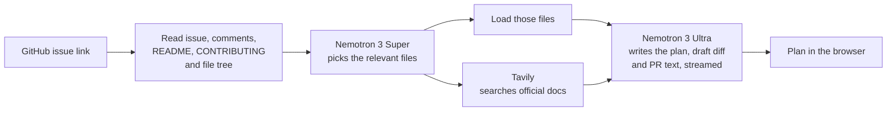

# FirstPR

**Your first pull request, mapped out.**

FirstPR is an AI mentor for first-time open-source contributors. Paste a GitHub issue and it reads the repository, finds the files that matter, checks the docs and writes:

- what the issue means, in plain words
- how hard it is and roughly how long it takes
- which files to open, and why
- a step-by-step plan and a draft diff
- how to test the change
- a ready pull request description
- a polite comment to claim the issue

Built for the **Nebius × NVIDIA Global AI Hackathon** (Best Apps and Agents track) with **NVIDIA Nemotron** models served on **Nebius Token Factory**, plus **Tavily** for docs search.

---

## Why

I'm a contributor in GirlScript Summer of Code ’26, Social Summer of Code Season 5 and Open Source Connect India, and I'm preparing for GSoC 2027. The hardest part of a first contribution usually isn't the code. It's opening an unfamiliar repository and not knowing where to start, what the maintainers expect, or how to write the PR.

FirstPR gives newcomers that starting point in about a minute, grounded in the real files of the real repository.

## How it works



1. **Read the issue** (`/api/issue`): the issue, comments, labels, assignees, the README, CONTRIBUTING and the repository file tree from the GitHub API. Build output, binaries and lockfiles are filtered out; very large repos are narrowed to the paths most related to the issue.
2. **Find the files** (`/api/locate`): **Nemotron 3 Super** gets the issue and the file list and returns JSON with 3–6 files and a docs search query. Only paths that really exist in the tree are kept, then those files are downloaded.
3. **Check the docs** (`/api/docs`): **Tavily** searches the web with the query from step 2.
4. **Write the plan** (`/api/plan`): **Nemotron 3 Ultra** reasons over everything (issue, guides, files and docs) and streams a plan with fixed sections back to the browser over Server-Sent Events.

FirstPR also warns you when an issue is closed or already assigned to someone, so you don't start work you can't submit.

## How NVIDIA Nemotron and Nebius Token Factory are used

| Step | Model (Token Factory ID) | Why this model |
|---|---|---|
| Pick the files | `nvidia/nemotron-3-super-120b-a12b` | Fast and low-cost for a short, structured JSON answer |
| Write the plan | `nvidia/Nemotron-3-Ultra-550b-a55b` | Strongest reasoning for reading code and planning a change |

- All model calls go to the **Nebius Token Factory** OpenAI-compatible API (`https://api.tokenfactory.nebius.com/v1`) with plain `fetch`, no SDK. See [`api/_lib/nebius.js`](api/_lib/nebius.js).
- The plan is **streamed** token by token. If the model sends its reasoning separately or inside `<think>` tags, FirstPR shows a "thinking" state and keeps the reasoning out of the plan.
- Routing work between two Nemotron sizes keeps the app responsive and makes the credits last: the cheap model does the narrow task, the big model only runs once per plan.
- The models can be swapped with environment variables (`NEBIUS_FAST_MODEL`, `NEBIUS_SMART_MODEL`) without code changes.
- `GET /api/health` and `npm run check` list the NVIDIA models your key can use and confirm the configured IDs exist.

## Tech stack

- **Frontend:** React 19 + Vite, plain CSS, `marked` + `DOMPurify` for safe markdown rendering
- **Backend:** Vercel serverless functions (Node.js), no database
- **AI:** NVIDIA Nemotron 3 Super and Nemotron 3 Ultra on Nebius Token Factory
- **Search:** Tavily Search API
- **Data:** GitHub REST API and raw file downloads (public repositories only)

## Run it locally

Requirements: Node.js 20+.

```bash
git clone https://github.com/vidhisingh24/FirstPR.git
cd FirstPR
npm install
cp .env.example .env    # then add your keys
npm run check           # checks your Nebius key and model IDs
npm run dev             # http://localhost:5173
```

`npm run dev` serves the frontend and the `/api` functions together, so you don't need any other tool.

### Environment variables

| Name | Required | What it's for |
|---|---|---|
| `NEBIUS_API_KEY` | Yes | Nebius Token Factory API key |
| `TAVILY_API_KEY` | No | Docs search (skipped if missing) |
| `GITHUB_TOKEN` | No, recommended | Raises GitHub's limit from 60 to 5,000 requests per hour. A fine-grained token with read-only access to public repositories is enough. |
| `NEBIUS_FAST_MODEL` | No | Override the file-picking model |
| `NEBIUS_SMART_MODEL` | No | Override the planning model |

## Deploy on Vercel

1. Import this repository in Vercel (framework preset: Vite).
2. Add the environment variables above in **Project → Settings → Environment Variables**.
3. Deploy. The API functions run on Vercel with a 60-second limit (see `vercel.json`).

## Project structure

```
api/
  issue.js        GitHub issue, repo, file tree, README and CONTRIBUTING
  locate.js       Nemotron 3 Super picks files; loads them
  docs.js         Tavily docs search
  plan.js         Nemotron 3 Ultra streams the plan (SSE)
  health.js       Keys and available NVIDIA models
  _lib/           GitHub, Nebius, Tavily helpers and the prompts
src/
  App.jsx         The four-step flow and page layout
  components/     Form, live steps, context panel, plan view
  lib/            API + streaming client, markdown rendering
scripts/check.js  Setup check for your keys and models
```

## Limits and safety

- Works with **public** GitHub repositories only and never writes to GitHub.
- Nothing is stored: no database, no accounts, no tracking.
- API keys stay on the server; the browser only talks to `/api`.
- A simple per-IP rate limit protects the hosted demo's credits.
- Plans are AI-generated drafts. Always run the code and the tests before opening a pull request.

## License

[MIT](LICENSE) © Vidhi Singh
